# Journey ทุกฟังก์ชัน — คนส. CoNnextS

เอกสารฉบับเดียวสำหรับ (1) สช. และผู้สนับสนุน (2) ผู้ทดลองใช้ (3) บันทึกผู้พัฒนา
เวอร์ชันเว็บที่ดูภาพหน้าจอได้เต็ม: `/journey` · ภาพหน้าจอทั้งหมด: `public/journey/`

## ภาพรวมแนวคิด

เปลี่ยน “การเจอกันในงานสมัชชาสุขภาพแห่งชาติ” ให้กลายเป็น “ความร่วมมือที่มีเจ้าภาพและวันนัดจริง”
โดยไล่ผู้ใช้จาก โปรไฟล์พลัง → คู่เชื่อมที่มีเหตุผลรองรับ → คำมั่นสัญญาที่ติดตามได้ → ผลงานที่กลายเป็นคลังความรู้

```text
หน้าบ้าน (มือถือ)                    แกนข้อมูลกลาง                    หลังบ้าน /admin
/scan → /start → /onboarding  ─┐
/matches /map /marketplace     ├─►  lib/store.ts (React Context)  ◄─┬─ /admin/people /ideas
/connection /chat /calendar    │     ├ localStorage: connecting-power-v1  ├─ /submissions /map
/commitments /submit /ebook   ─┘     ├ lib/live.ts: BroadcastChannel      ├─ /connections /commitments
                                     └ lib/matching.ts: คะแนนแมตช์        └─ /live /qr /import /export
บัญชี: /auth ─► Lovable Cloud (อีเมล/Google) ─► ผูกโปรไฟล์ guest เดิม
```

ข้อมูลกิจกรรมปัจจุบันเก็บในเครื่องผู้ใช้ (localStorage) เพื่อให้ทดลองใช้หน้างานได้ทันที
ส่วนบัญชีผู้ใช้เชื่อมระบบคลาวด์แล้ว — เฟสถัดไปคือย้ายข้อมูลกิจกรรมขึ้นฐานข้อมูลกลางเพื่อซิงก์ข้ามอุปกรณ์

## เส้นทางผู้เข้าร่วม (หน้าบ้าน)

จากสแกน QR → โปรไฟล์พลัง → คู่เชื่อม → คำมั่นสัญญา → ผลงาน

### 1. หน้าแรก — เข้าใจงานภายใน 10 วินาที — `/`

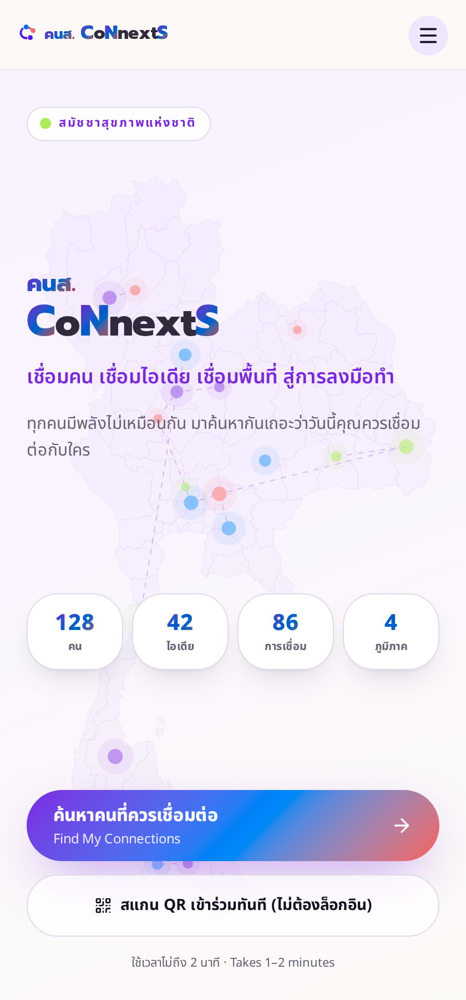

**เป้าหมาย:** อธิบายว่างานนี้คือพื้นที่จับคู่พลังของคนในสมัชชาสุขภาพแห่งชาติ และพาเข้าสู่ทางเข้าที่ถูกต้อง

| ผู้ใช้ทำอะไรได้ | ข้อมูลเข้า | ข้อมูลออก |
| --- | --- | --- |
| กด “เริ่มสร้างโปรไฟล์พลัง” | ไม่มี (หน้าอ่านอย่างเดียว) | จำนวนสมาชิก/ไอเดียปัจจุบัน |
| เปิดเมนูหลักจากปุ่มด้านบน |  | ทางลัดไปทุกเมนู |
| ดูภาพเครือข่ายจุดเชื่อมบนแผนที่ประเทศไทย |  |  |

**เชื่อมหลังบ้าน:** อ่านสถิติสดจาก store (connecting-power-v1) ผ่าน useStore() ไม่มีการเขียนข้อมูล

### 2. สแกน QR / ใส่รหัสห้อง — `/scan`

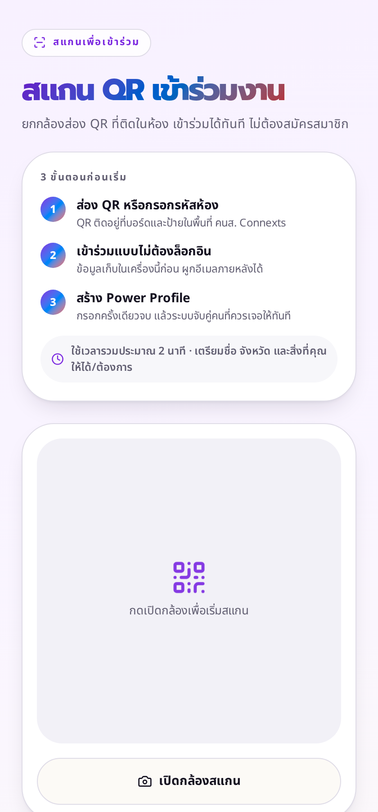

**เป้าหมาย:** ให้ผู้เข้าร่วมหน้างานเริ่มใช้ได้ทันทีโดยไม่ต้องล็อกอิน

| ผู้ใช้ทำอะไรได้ | ข้อมูลเข้า | ข้อมูลออก |
| --- | --- | --- |
| สแกน QR จากป้ายในงาน | รหัสห้อง (code) | ขั้นตอน 3 สเต็ปก่อนเริ่ม |
| พิมพ์รหัสห้อง (เช่น NHA26) |  | สถานะการเข้าร่วมสำเร็จ |
| กด “เริ่มออนบอร์ดดิ้งด้วยเดโม่” |  |  |

**เชื่อมหลังบ้าน:** createSession('qr', code) เขียน localStorage คีย์ connecting-power-session แล้ว redirect ไป /start — เป็นการเข้าร่วมแบบ guest ไม่แตะระบบบัญชี

### 3. เริ่มต้นแบบผู้เยี่ยมชม (Guest) — `/start`

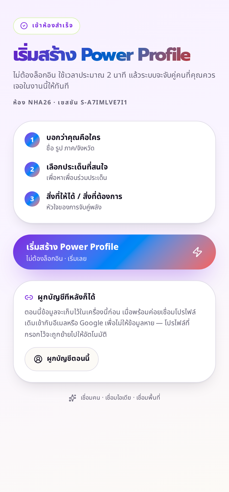

**เป้าหมาย:** ลดแรงเสียดทาน: ทำโปรไฟล์ก่อน ค่อยผูกบัญชีทีหลัง

| ผู้ใช้ทำอะไรได้ | ข้อมูลเข้า | ข้อมูลออก |
| --- | --- | --- |
| เลือกทำโปรไฟล์ทันที | การเลือกเส้นทาง | สรุปสิ่งที่จะได้รับหลังทำโปรไฟล์ |
| หรือเลือกล็อกอิน/สมัครเพื่อผูกบัญชี |  |  |

**เชื่อมหลังบ้าน:** อ่าน session จาก session.ts และสถานะบัญชีจาก lib/auth.tsx (Lovable Cloud)

### 4. ล็อกอิน / สมัคร / ผูกโปรไฟล์เดิม — `/auth`

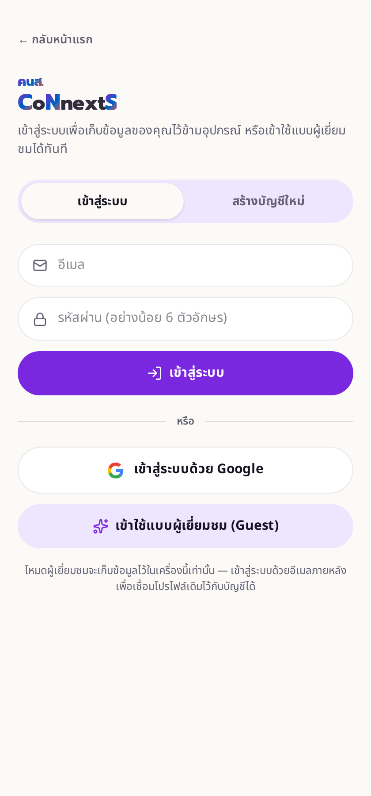

**เป้าหมาย:** กันข้อมูลหายเมื่อเปลี่ยนเครื่อง และรองรับผู้ใช้ที่อยากมีบัญชีจริง

| ผู้ใช้ทำอะไรได้ | ข้อมูลเข้า | ข้อมูลออก |
| --- | --- | --- |
| สมัครหรือเข้าสู่ระบบด้วยอีเมล | อีเมล/รหัสผ่าน หรือ Google OAuth | สถานะเซสชันผู้ใช้ |
| เข้าด้วย Google |  | แจ้งผลการผูกโปรไฟล์ |
| ผูกโปรไฟล์ guest เดิมเข้ากับบัญชี |  |  |

**เชื่อมหลังบ้าน:** ใช้ auth ของ Lovable Cloud ผ่าน @/integrations/supabase/client เมื่อผูกสำเร็จ จะเขียน linked_email / linked_user_id / linked_at ลงโปรไฟล์ใน store

### 5. สร้าง Power Profile (แบบฟอร์มเดียวจบ) — `/onboarding`

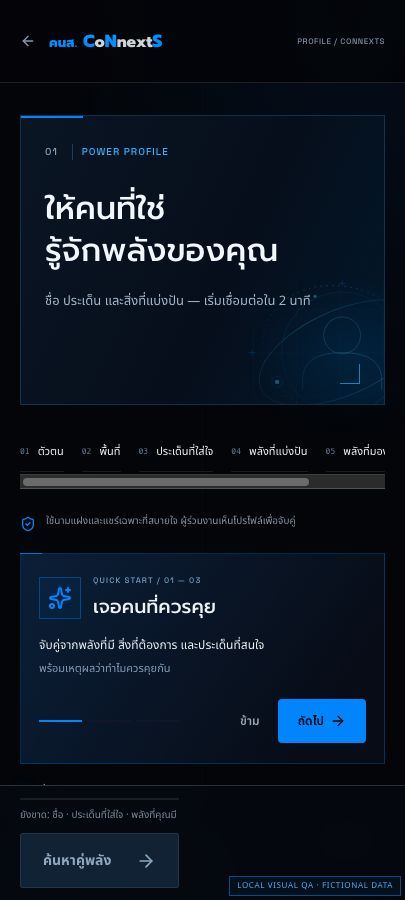

**เป้าหมาย:** เก็บข้อมูลที่ระบบจับคู่ต้องใช้ ในรูปแบบเส้นตรงไม่ซ้ำซ้อน

| ผู้ใช้ทำอะไรได้ | ข้อมูลเข้า | ข้อมูลออก |
| --- | --- | --- |
| กรอกชื่อ องค์กร จังหวัด/ภาค เจเนอเรชัน | name, organization, province, region, generation, bio | โปรไฟล์ที่บันทึกแล้ว |
| เลือกประเด็นที่สนใจ | interests[], powers_have[], powers_need[] | พาไปหน้าคู่เชื่อมทันที |
| เลือก “พลังที่มี” และ “พลังที่ต้องการ” | photo (data URL, ไม่บังคับ) |  |
| แนบรูปโปรไฟล์ (ตัวเลือก) |  |  |

**เชื่อมหลังบ้าน:** saveProfile() ใน store (connecting-power-v1) สร้าง user id = "me" พร้อม created_at/updated_at และส่งสัญญาณ emitLive('profile') ให้จอสด

### 6. คู่เชื่อมของฉัน — ปัดเร็ว / ทั้งหมด / ถูกใจ — `/matches`

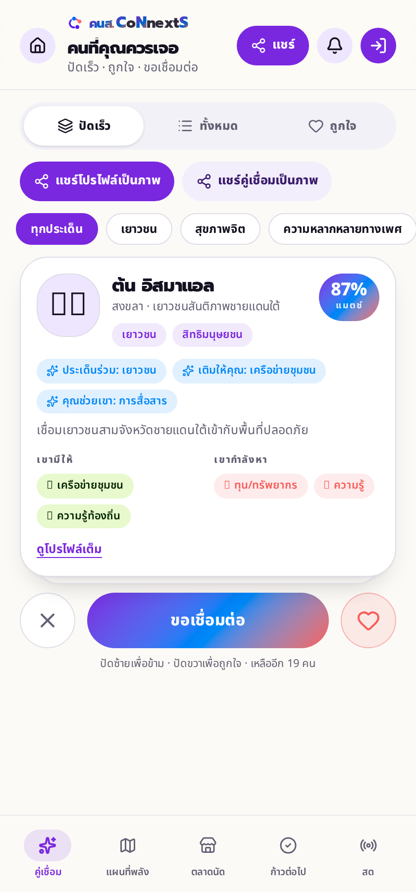

**เป้าหมาย:** หาคนที่ควรคุยด้วยที่สุด พร้อมเหตุผลสั้น ๆ ว่าทำไมถึงแมตช์

| ผู้ใช้ทำอะไรได้ | ข้อมูลเข้า | ข้อมูลออก |
| --- | --- | --- |
| ปัดขวา = ถูกใจ, ปัดซ้าย = ข้าม | likedUsers[], skippedUsers[] | คะแนนแมตช์ % ต่อคน |
| กด “ขอเชื่อมต่อ” | การกดขอเชื่อมต่อ | เหตุผลแมตช์ (ประเด็นร่วม / เขาเติมให้คุณ / คุณช่วยเขา) |
| กรองตามประเด็น |  | พลังที่เขามีและกำลังหา |
| แชร์การ์ดแมตช์เป็นรูปภาพ |  |  |

**เชื่อมหลังบ้าน:** คำนวณด้วย lib/matching.ts (need↔have 40% · ประเด็น 30% · ทักษะ 20% · ภูมิภาค 10%) การกดเชื่อมเรียก connect() สร้าง Connection + Notification + emitLive('connection')

### 7. โปรไฟล์รายบุคคล — `/people/$id`

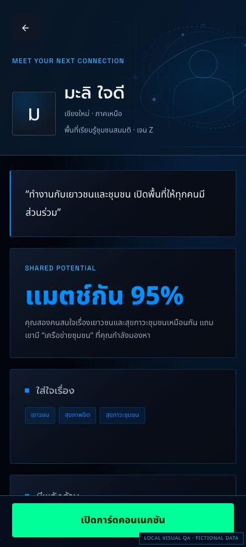

**เป้าหมาย:** ดูรายละเอียดก่อนตัดสินใจเชื่อม

| ผู้ใช้ทำอะไรได้ | ข้อมูลเข้า | ข้อมูลออก |
| --- | --- | --- |
| อ่านคำอธิบาย พลัง ประเด็น จังหวัด | การขอเชื่อมต่อ | ข้อมูลโปรไฟล์เต็ม + คะแนนความเข้ากัน |
| กดขอเชื่อมต่อจากหน้านี้ |  |  |

**เชื่อมหลังบ้าน:** อ่าน users จาก store (connecting-power-v1) ตาม params.id

### 8. รายละเอียดคู่เชื่อม + คำมั่นสัญญา — `/connection/$id`

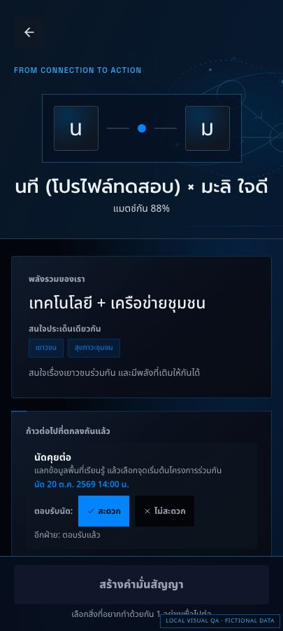

**เป้าหมาย:** แปลง “การเจอกัน” ให้เป็น “งานที่จะทำร่วมกันจริง”

| ผู้ใช้ทำอะไรได้ | ข้อมูลเข้า | ข้อมูลออก |
| --- | --- | --- |
| ตั้งคำมั่นสัญญา (สิ่งที่จะทำร่วมกัน) | commitment.text, due_date, status | ไทม์ไลน์ความคืบหน้า |
| เลือกวันนัด | rsvp ของแต่ละฝ่าย | ปุ่มขั้นถัดไปที่ควรทำ |
| ตอบรับ/ปฏิเสธนัด (RSVP) |  |  |
| เปลี่ยนสถานะคู่เชื่อม |  |  |
| เข้าห้องแชท |  |  |

**เชื่อมหลังบ้าน:** addCommitment/updateCommitment/setRsvp ใน store → เขียน localStorage + emitLive('commitment') ให้ /dashboard และ /admin/live เห็นทันที

### 9. ห้องแชทของคู่เชื่อม — `/chat/$id`

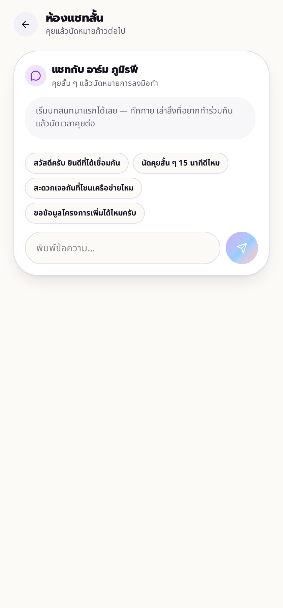

**เป้าหมาย:** คุยต่อทันทีโดยไม่ต้องแลกไลน์

| ผู้ใช้ทำอะไรได้ | ข้อมูลเข้า | ข้อมูลออก |
| --- | --- | --- |
| ส่งข้อความ | ข้อความแชท | ประวัติสนทนา + การ์ดนัดหมายพร้อมปุ่มไปหน้ารายละเอียด |
| รับการ์ดนัดหมายที่ส่งมาจากหน้าปฏิทิน |  |  |

**เชื่อมหลังบ้าน:** messages เก็บใน store ต่อ connection id (เดโม่มีระบบตอบกลับอัตโนมัติเพื่อจำลองบทสนทนา)

### 10. แผนที่พลัง 77 จังหวัด — `/map`

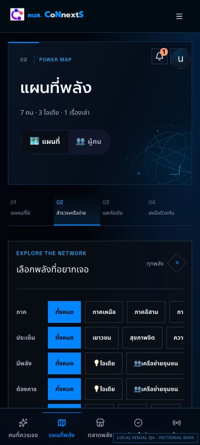

**เป้าหมาย:** เห็นภาพว่าเครือข่ายกระจายอยู่ที่ไหน และเปิดบันทึกรายจังหวัด

| ผู้ใช้ทำอะไรได้ | ข้อมูลเข้า | ข้อมูลออก |
| --- | --- | --- |
| แตะจังหวัดเพื่อดูสมาชิก | ProvinceNote: province, title, detail, issues[] | จำนวนคนต่อจังหวัด |
| เพิ่มบันทึก/สถานการณ์ของจังหวัด |  | รายการบันทึกของจังหวัดนั้น |
| กรองตามภาค/ประเด็น |  |  |

**เชื่อมหลังบ้าน:** รูปทรงจังหวัดจาก lib/thailand-geo.ts · บันทึกเก็บที่ provinceNotes ใน store และแก้ไขได้ที่ /admin/map

### 11. ตลาดนัดพลัง (ไอเดียความร่วมมือ) — `/marketplace`

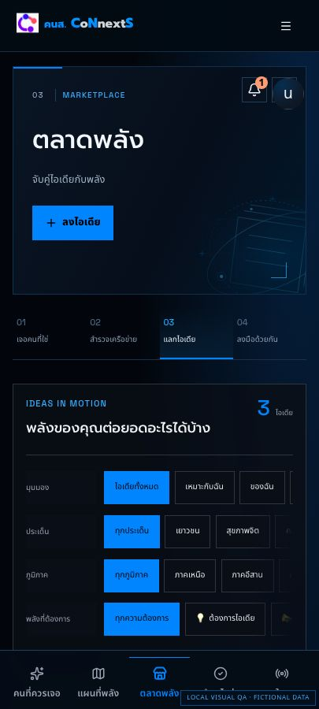

**เป้าหมาย:** ประกาศไอเดียที่อยากทำ และหาคนมาเติมทรัพยากรที่ขาด

| ผู้ใช้ทำอะไรได้ | ข้อมูลเข้า | ข้อมูลออก |
| --- | --- | --- |
| โพสต์ไอเดีย | Idea: title, description, region, issues[], resources_have[], resources_need[] | การ์ดไอเดียพร้อมสิ่งที่มี/สิ่งที่ขาด |
| บันทึกไอเดียที่สนใจ |  | ไอเดียที่บันทึกไว้ |
| ทักเจ้าของไอเดีย |  |  |

**เชื่อมหลังบ้าน:** ideas[] และ savedIdeas[] ใน store (connecting-power-v1) · ผู้ดูแลแก้/ซ่อน/ลบได้ที่ /admin/ideas

### 12. ก้าวต่อไปของฉัน — `/commitments`

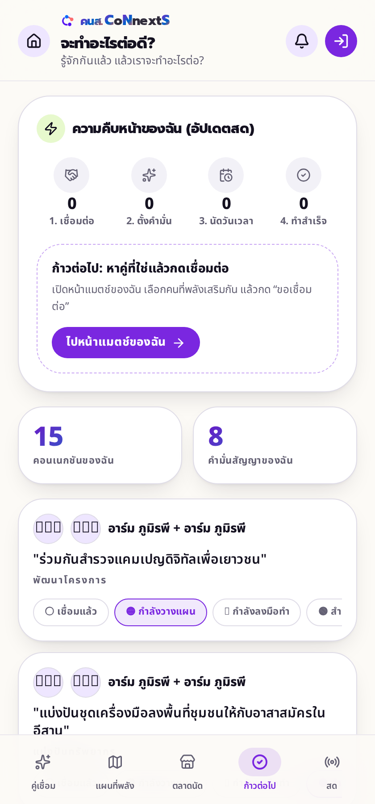

**เป้าหมาย:** รวมทุกคำมั่นสัญญาไว้ที่เดียว ไม่ให้ความร่วมมือหายไปหลังงานจบ

| ผู้ใช้ทำอะไรได้ | ข้อมูลเข้า | ข้อมูลออก |
| --- | --- | --- |
| อัปเดตสถานะ | สถานะคำมั่นสัญญา (ยังไม่เริ่ม → กำลังทำ → เสร็จ) | สัดส่วนความคืบหน้า |
| ตั้ง/แก้วันนัด |  | ข้อความนำทางขั้นถัดไป (live-progress) |
| ดูแผงความคืบหน้าสด |  |  |

**เชื่อมหลังบ้าน:** components/live-progress.tsx อ่าน store + live event bus แล้วคำนวณคำแนะนำขั้นถัดไปแบบเรียลไทม์

### 13. ปฏิทินนัดหมาย — `/calendar`

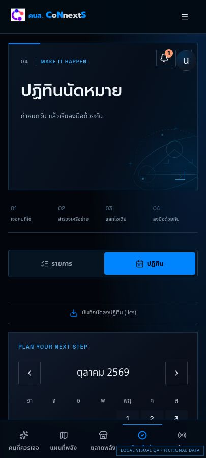

**เป้าหมาย:** จัดตารางนัดต่อเนื่องหลังงาน และเตือนก่อนถึงเวลา

| ผู้ใช้ทำอะไรได้ | ข้อมูลเข้า | ข้อมูลออก |
| --- | --- | --- |
| เลือกวันบนปฏิทิน พ.ศ. | due_date, rsvp | นัดของแต่ละวัน |
| RSVP |  | ชิปนับถอยหลังก่อนถึงนัด |
| ส่งนัดเข้าห้องแชท |  | ไฟล์ iCal |
| ดาวน์โหลด .ics / เปิด Google Calendar |  |  |

**เชื่อมหลังบ้าน:** lib/ical.ts สร้างไฟล์ .ics ฝั่งเบราว์เซอร์ · components/commitment-reminders.tsx ยิงเสียง/เตือนตามเวลา

### 14. แดชบอร์ดกิจกรรมสด — `/dashboard`

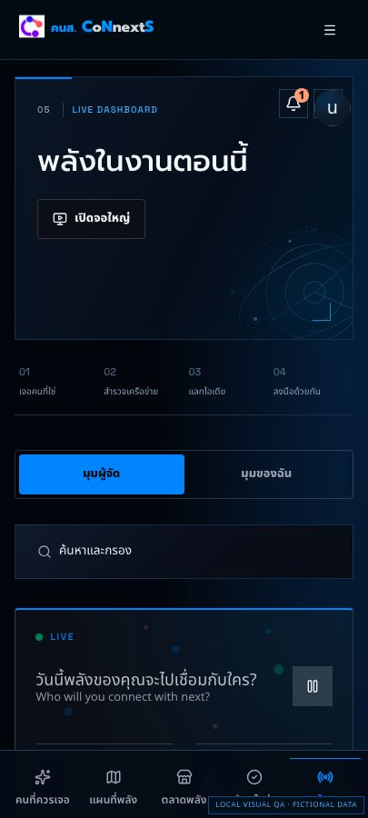

**เป้าหมาย:** ให้ผู้จัดและผู้เข้าร่วมเห็นพลังของงานแบบเรียลไทม์

| ผู้ใช้ทำอะไรได้ | ข้อมูลเข้า | ข้อมูลออก |
| --- | --- | --- |
| กรองตามภาค/ประเด็น/ประเภทพลัง | ตัวกรอง (sync กับ URL search params) | จำนวนแมตช์/คู่เชื่อม/คำมั่นสัญญา |
| เรียงตามความเกี่ยวข้อง | ชุดตัวกรองที่บันทึก | ตัวหนังสือวิ่งกิจกรรมสด |
| บันทึกชุดตัวกรอง |  | ไฟล์ส่งออก |
| แชร์ลิงก์ผลลัพธ์ |  |  |
| ส่งออก CSV/JSON |  |  |

**เชื่อมหลังบ้าน:** lib/live.ts ใช้ BroadcastChannel ซิงก์ข้ามแท็บ · lib/relevance.ts จัดอันดับ · lib/filter-presets.ts เก็บชุดตัวกรอง · lib/export.ts สร้าง CSV/JSON (UTF-8 BOM รองรับภาษาไทยใน Excel)

### 15. การแจ้งเตือน — `/notifications`

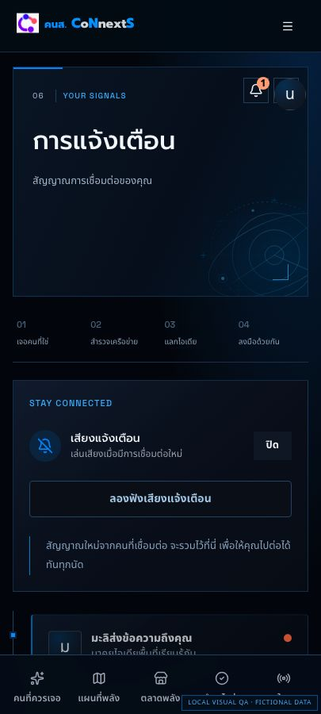

**เป้าหมาย:** รู้ทันทีเมื่อมีคนตอบรับ มีแมตช์ใหม่ หรือใกล้ถึงนัด

| ผู้ใช้ทำอะไรได้ | ข้อมูลเข้า | ข้อมูลออก |
| --- | --- | --- |
| อ่าน/ล้างการแจ้งเตือน | สถานะอ่านแล้ว | รายการแจ้งเตือนพร้อมเวลา |
| กดไปยังคู่เชื่อมที่เกี่ยวข้อง |  |  |

**เชื่อมหลังบ้าน:** lib/notify.ts เล่นเสียง “ปิ๊ง” + เสียงพูด “connext” · filter-alerts.tsx เตือนเมื่อมีคนตรงชุดตัวกรองที่บันทึกไว้

### 16. ส่งผลงาน/บทเรียนเข้าคลัง — `/submit`

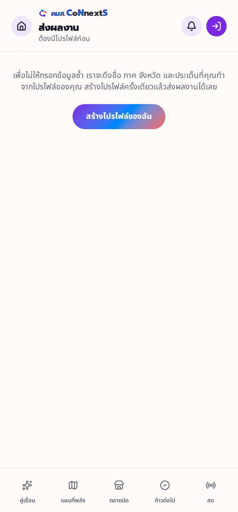

**เป้าหมาย:** เก็บผลผลิตจากงานให้กลายเป็นองค์ความรู้ร่วม

| ผู้ใช้ทำอะไรได้ | ข้อมูลเข้า | ข้อมูลออก |
| --- | --- | --- |
| กรอกชื่อผลงาน ประเด็น พื้นที่ บทเรียน | Submission: title, summary, issues[], province, links | ยืนยันการส่ง และสถานะรอผู้ดูแลอนุมัติขึ้นโชว์ |
| แนบลิงก์/รูป |  |  |

**เชื่อมหลังบ้าน:** submissions[] ใน store (connecting-power-v1) · ผู้ดูแลติ๊ก showcase ที่ /admin/submissions เพื่อดันขึ้น e-book

### 17. e-book รวมผลงาน — `/ebook`

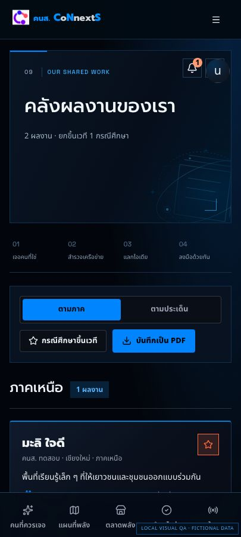

**เป้าหมาย:** ใช้เป็นเล่มสรุปงานที่เปิดอ่านและพิมพ์ได้ทันที

| ผู้ใช้ทำอะไรได้ | ข้อมูลเข้า | ข้อมูลออก |
| --- | --- | --- |
| อ่านผลงานแบ่งตามประเด็น | ไม่มี | สารบัญ + เนื้อหาผลงานที่ถูกอนุมัติ |
| สั่งพิมพ์/บันทึก PDF |  |  |

**เชื่อมหลังบ้าน:** อ่าน submissions ที่ showcase = true

### 18. แก้ไขโปรไฟล์ของฉัน — `/update`

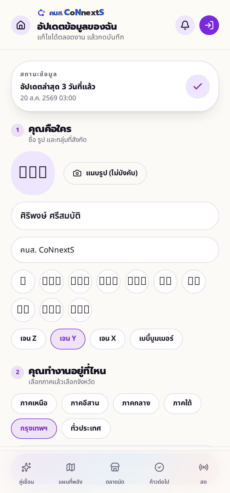

**เป้าหมาย:** ปรับพลัง/ประเด็นให้ตรงขึ้น แล้วผลแมตช์จะเปลี่ยนตามทันที

| ผู้ใช้ทำอะไรได้ | ข้อมูลเข้า | ข้อมูลออก |
| --- | --- | --- |
| แก้ทุกฟิลด์ในฟอร์มเดียวกับออนบอร์ดดิ้ง | ฟิลด์โปรไฟล์เดิมทั้งหมด | โปรไฟล์ใหม่ + คะแนนแมตช์ที่คำนวณใหม่ |

**เชื่อมหลังบ้าน:** ใช้ components/profile-form.tsx ตัวเดียวกับ /onboarding เพื่อไม่ให้ข้อมูลซ้ำซ้อน

### 19. QR สำหรับเชิญเข้าร่วม — `/qr`

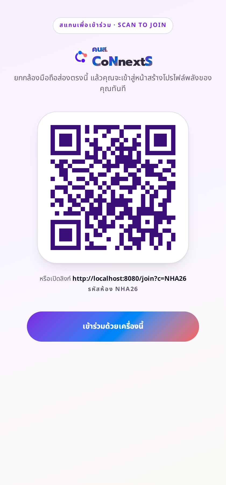

**เป้าหมาย:** ให้ทีมงานเปิดจากมือถือแล้วให้คนอื่นสแกนได้เลย

| ผู้ใช้ทำอะไรได้ | ข้อมูลเข้า | ข้อมูลออก |
| --- | --- | --- |
| แสดง QR เต็มจอ | ไม่มี | QR + รหัสห้อง |
| คัดลอกลิงก์/รหัสห้อง |  |  |

**เชื่อมหลังบ้าน:** สร้าง QR ฝั่งไคลเอนต์จาก origin ปัจจุบัน

### 20. ชุดไฟล์พิมพ์บอร์ด/ป้าย — `/print`

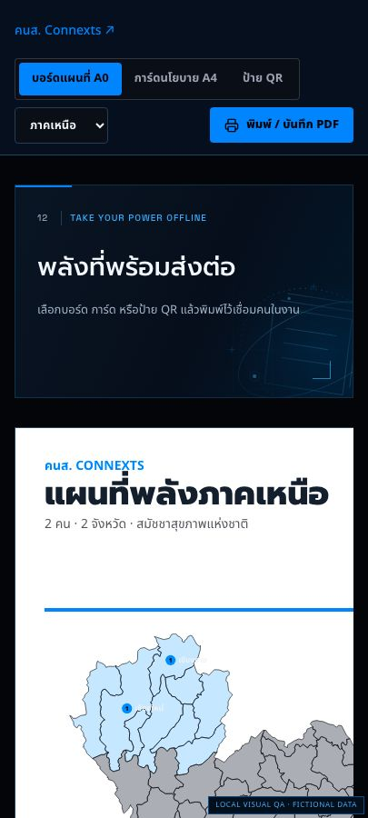

**เป้าหมาย:** เตรียมสื่อหน้างานโดยไม่ต้องพึ่งกราฟิก

| ผู้ใช้ทำอะไรได้ | ข้อมูลเข้า | ข้อมูลออก |
| --- | --- | --- |
| สั่งพิมพ์บอร์ดแนะนำงาน ป้าย QR และป้ายโต๊ะ | ไม่มี | เลย์เอาต์พร้อมพิมพ์ (print CSS) |

**เชื่อมหลังบ้าน:** เรนเดอร์ฝั่งไคลเอนต์ทั้งหมด

## เส้นทางผู้ดูแล (หลังบ้าน /admin)

ล็อกอินด้วยบัญชีผู้ดูแล (ดู `docs/ADMIN.md`) — ครอบคลุมทุกเมนูที่มีบนเว็บ

### A1. ประตูหลังบ้าน + ภาพรวม — `/admin`

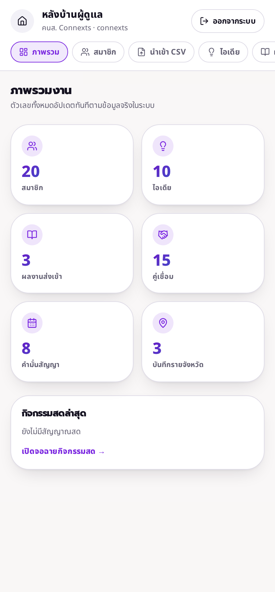

**เป้าหมาย:** ผู้ดูแลเข้าจุดเดียวเห็นทุกตัวเลขของงาน

| ผู้ใช้ทำอะไรได้ | ข้อมูลเข้า | ข้อมูลออก |
| --- | --- | --- |
| ล็อกอินด้วยบัญชีผู้ดูแล | ชื่อผู้ใช้/รหัสผ่านผู้ดูแล | จำนวนสมาชิก ไอเดีย ผลงาน คู่เชื่อม คำมั่นสัญญา บันทึกจังหวัด |
| ดูสถิติรวม |  | ฟีดกิจกรรมสดล่าสุด |
| กดเข้าเมนูย่อยทั้ง 12 เมนู |  |  |

**เชื่อมหลังบ้าน:** ตรวจรหัสที่เซิร์ฟเวอร์ (adminLogin) แล้วเก็บโทเคนลงลายเซ็นที่ localStorage คีย์ connext-admin-token

### A2. จัดการสมาชิก — `/admin/people`

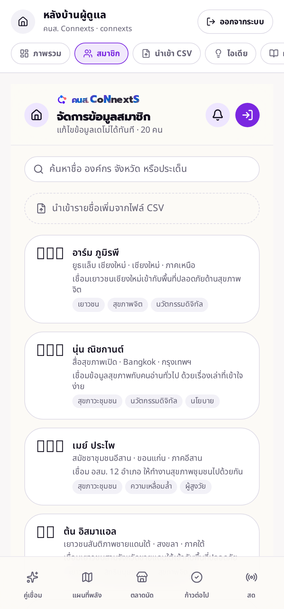

**เป้าหมาย:** แก้ข้อมูลผู้เข้าร่วมได้ทันทีหน้างาน

| ผู้ใช้ทำอะไรได้ | ข้อมูลเข้า | ข้อมูลออก |
| --- | --- | --- |
| ค้นหา | patch ของ User | รายชื่อพร้อมข้อมูลล่าสุด |
| แก้ชื่อ องค์กร จังหวัด ประเด็น คำอธิบาย |  |  |
| ลบสมาชิก |  |  |

**เชื่อมหลังบ้าน:** updateUser / removeUser ใน store — ผลกระทบเห็นทันทีที่ฝั่งผู้ใช้เพราะใช้ state ก้อนเดียวกัน

### A3. จัดการไอเดีย — `/admin/ideas`

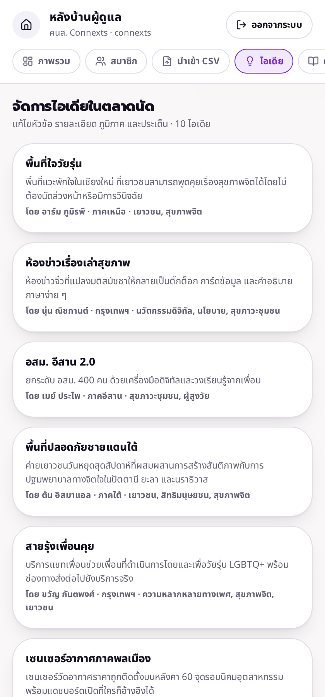

**เป้าหมาย:** คุมคุณภาพเนื้อหาในตลาดนัดพลัง

| ผู้ใช้ทำอะไรได้ | ข้อมูลเข้า | ข้อมูลออก |
| --- | --- | --- |
| แก้หัวข้อ/รายละเอียด | patch ของ Idea | รายการไอเดียทั้งหมดพร้อมเจ้าของ |
| ลบไอเดียที่ไม่เหมาะสม |  |  |

**เชื่อมหลังบ้าน:** updateIdea / removeIdea

### A4. จัดการผลงานที่ส่งเข้ามา — `/admin/submissions`

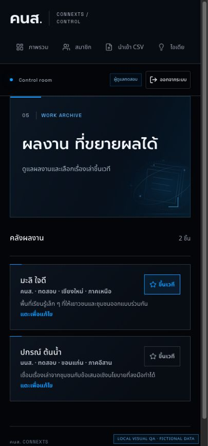

**เป้าหมาย:** คัดผลงานขึ้น e-book

| ผู้ใช้ทำอะไรได้ | ข้อมูลเข้า | ข้อมูลออก |
| --- | --- | --- |
| แก้ไขเนื้อหา | patch ของ Submission (รวม showcase) | สถานะผลงานแต่ละชิ้น |
| ติ๊ก showcase เพื่อขึ้นโชว์ |  |  |
| ลบ |  |  |

**เชื่อมหลังบ้าน:** updateSubmission / removeSubmission → /ebook อัปเดตทันที

### A5. จัดการแผนที่/บันทึกรายจังหวัด — `/admin/map`

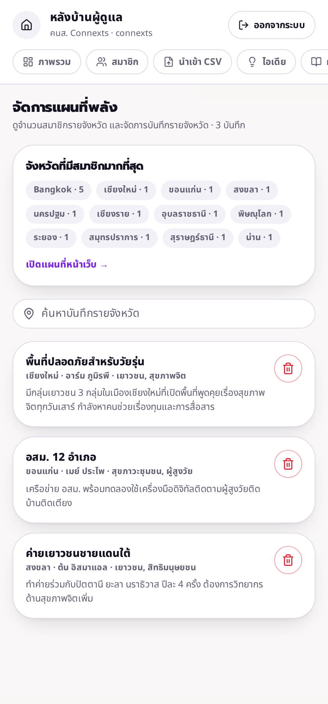

**เป้าหมาย:** ดูจังหวัดที่คึกคักและลบบันทึกที่ผิดพลาด

| ผู้ใช้ทำอะไรได้ | ข้อมูลเข้า | ข้อมูลออก |
| --- | --- | --- |
| ดูอันดับจังหวัดตามจำนวนสมาชิก | การลบบันทึก | สรุปจำนวนสมาชิกต่อจังหวัด + รายการบันทึก |
| ลบบันทึกรายจังหวัด |  |  |

**เชื่อมหลังบ้าน:** removeProvinceNote

### A6. จัดการคู่เชื่อม — `/admin/connections`

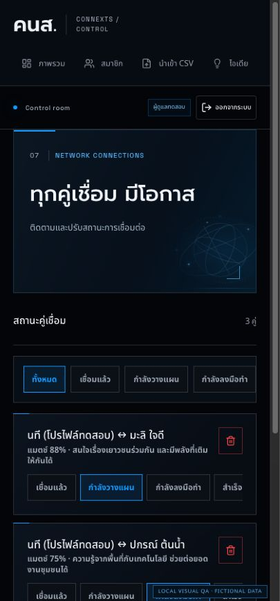

**เป้าหมาย:** ติดตามว่าการเชื่อมเดินไปถึงไหน

| ผู้ใช้ทำอะไรได้ | ข้อมูลเข้า | ข้อมูลออก |
| --- | --- | --- |
| เปลี่ยนสถานะ (Connected / Planning / In Progress / Completed) | ConnectionStatus | คู่เชื่อมทั้งหมด + คะแนนแมตช์ + เหตุผล |
| ลบคู่เชื่อม |  |  |

**เชื่อมหลังบ้าน:** setStatus / removeConnection พร้อมส่ง live event

### A7. จัดการคำมั่นสัญญา/ปฏิทินรวม — `/admin/commitments`

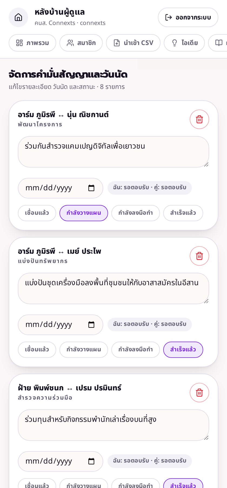

**เป้าหมาย:** เห็นนัดหมายทั้งงานในที่เดียว

| ผู้ใช้ทำอะไรได้ | ข้อมูลเข้า | ข้อมูลออก |
| --- | --- | --- |
| แก้ข้อความคำมั่น | text, due_date, status | รายการนัดเรียงตามวัน |
| แก้วันนัด |  |  |
| เปลี่ยนสถานะ |  |  |
| ลบ |  |  |

**เชื่อมหลังบ้าน:** updateCommitment / removeCommitment

### A8. จอฉายกิจกรรมสด — `/admin/live`

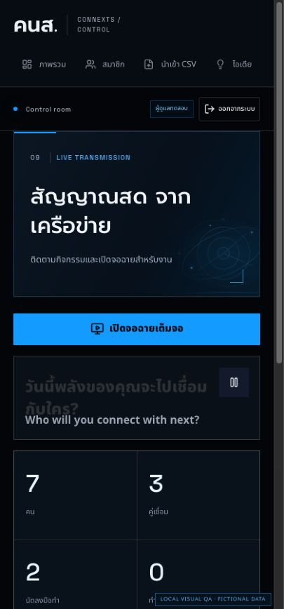

**เป้าหมาย:** ขึ้นจอโปรเจกเตอร์ในงานให้เห็นพลังที่เกิดขึ้นแบบเรียลไทม์

| ผู้ใช้ทำอะไรได้ | ข้อมูลเข้า | ข้อมูลออก |
| --- | --- | --- |
| เปิดโหมดเต็มจอ | ไม่มี | ตัวนับสด + เหตุการณ์ล่าสุด (เชื่อม/คำมั่น/โปรไฟล์ใหม่) |
| ดูตัวเลขและฟีดกิจกรรมวิ่ง |  |  |

**เชื่อมหลังบ้าน:** รับ event จาก BroadcastChannel ใน lib/live.ts ทุกแท็บ/ทุกอุปกรณ์ในเครื่องเดียวกัน

### A9. สร้าง QR และรหัสห้อง — `/admin/qr`

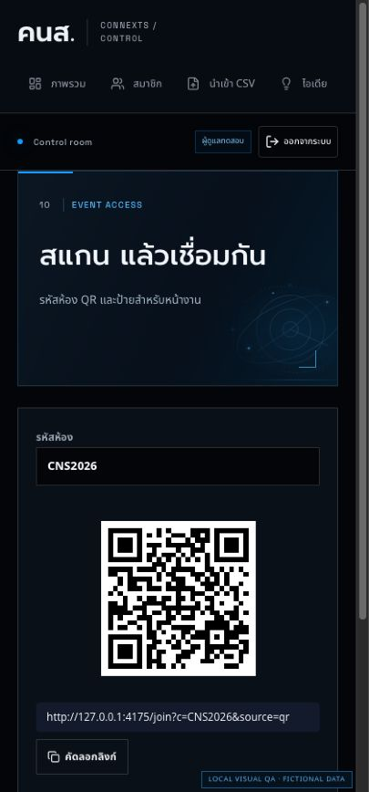

**เป้าหมาย:** ทีมงานพิมพ์ป้ายเองได้ทันที

| ผู้ใช้ทำอะไรได้ | ข้อมูลเข้า | ข้อมูลออก |
| --- | --- | --- |
| ตั้งรหัสห้อง | รหัสห้อง | QR + ลิงก์เข้าร่วม |
| แสดง/พิมพ์ QR |  |  |

**เชื่อมหลังบ้าน:** ลิงก์ชี้ไป /scan?code=... ซึ่งจะสร้าง session ให้อัตโนมัติ

### A10. นำเข้ารายชื่อจาก CSV — `/admin/import`

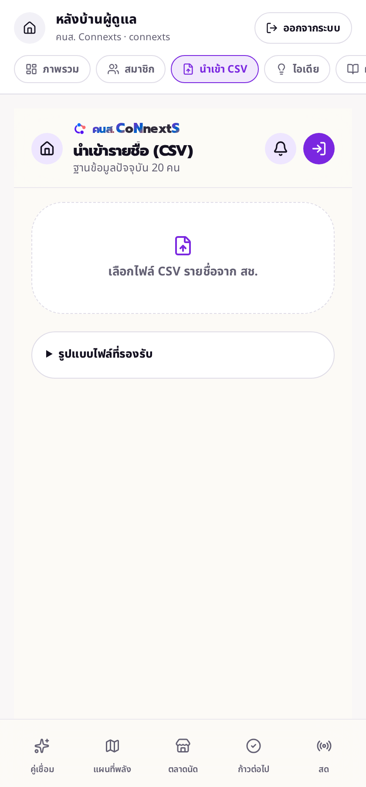

**เป้าหมาย:** เตรียมข้อมูลผู้ลงทะเบียนล่วงหน้าก่อนเปิดงาน

| ผู้ใช้ทำอะไรได้ | ข้อมูลเข้า | ข้อมูลออก |
| --- | --- | --- |
| อัปโหลดไฟล์ CSV | CSV: name, organization, province, region, interests, powers_have, powers_need, bio | จำนวนแถวที่นำเข้าสำเร็จ |
| ตรวจตัวอย่างก่อนนำเข้า |  |  |

**เชื่อมหลังบ้าน:** importUsers() แปลงเป็น User[] แล้วรวมเข้า store

### A11. ส่งออก/สำรองข้อมูล — `/admin/export`

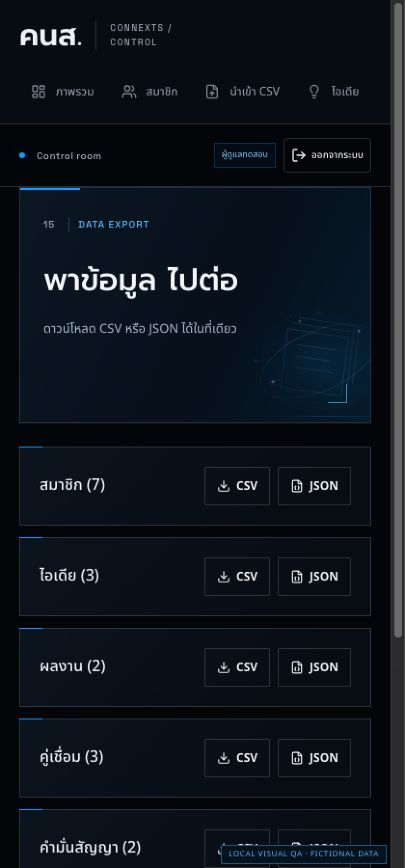

**เป้าหมาย:** เอาข้อมูลไปทำรายงานต่อ และสำรองกันข้อมูลหาย

| ผู้ใช้ทำอะไรได้ | ข้อมูลเข้า | ข้อมูลออก |
| --- | --- | --- |
| ส่งออก CSV/JSON แยกชุด | ไม่มี | ไฟล์ users / ideas / connections / commitments / submissions / province-notes |
| สำรองทั้งระบบเป็นไฟล์เดียว |  |  |

**เชื่อมหลังบ้าน:** lib/export.ts (CSV มี UTF-8 BOM เปิดใน Excel ภาษาไทยไม่เพี้ยน)

### A12. ตั้งค่าและโซนอันตราย — `/admin/settings`

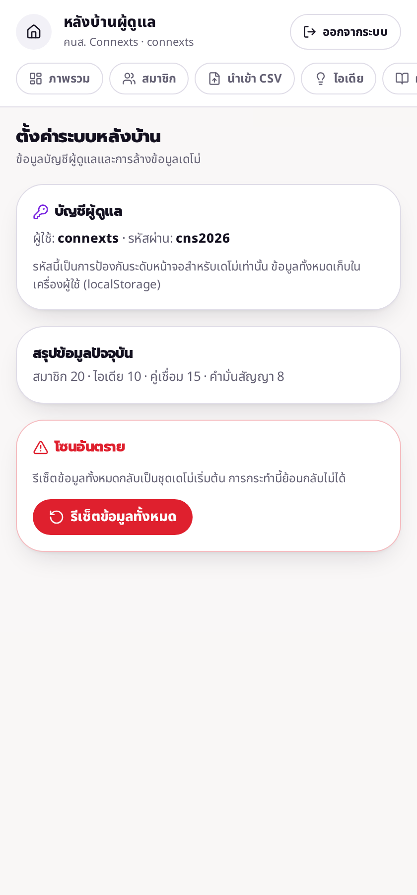

**เป้าหมาย:** ล้างข้อมูลกลับเป็นชุดเดโม่ก่อนเริ่มงานจริง

| ผู้ใช้ทำอะไรได้ | ข้อมูลเข้า | ข้อมูลออก |
| --- | --- | --- |
| ดูข้อมูลบัญชีผู้ดูแล | การยืนยันรีเซ็ต | สรุปจำนวนข้อมูลปัจจุบัน |
| รีเซ็ตข้อมูลทั้งหมด |  |  |

**เชื่อมหลังบ้าน:** reset() เขียนทับ store ด้วยชุด DEMO_* ทั้งหมด (ย้อนกลับไม่ได้ — ควรส่งออกก่อน)

## โครงสร้างข้อมูล (บันทึกผู้พัฒนา)

| ชนิดข้อมูล | ฟิลด์ | หมายเหตุ |
| --- | --- | --- |
| User | `id, name, avatar, photo?, province, region, organization, generation, bio, interests[], powers_have[], powers_need[], linked_email?` | โปรไฟล์ของฉันใช้ id = "me" |
| Connection | `id, user_a, user_b, match_score, match_reason, status, created_at` | สถานะ 4 ระดับ |
| Commitment | `id, connection_id, text, due_date, status, rsvp` | ผูกกับปฏิทินและ iCal |
| Idea | `id, title, description, owner_id, region, issues[], resources_have[], resources_need[]` | ตลาดนัดพลัง |
| Submission | `id, title, summary, issues[], province, links, showcase` | showcase = ขึ้น e-book |
| ProvinceNote | `id, province, author_id, author_name, title, detail, issues[]` | บันทึกบนแผนที่ |
| AppNotification | `id, title, detail, created_at, read` | แจ้งเตือนในแอป |

## หมายเหตุทางเทคนิค

- คีย์ในเครื่อง: `connecting-power-v1` (ข้อมูลทั้งหมด), `connecting-power-session` (เซสชันผู้เข้าร่วม), `connext-admin-token` (โทเคนหลังบ้าน)
- สูตรจับคู่: need↔have 40% · ประเด็นร่วม 30% · ทักษะ 20% · ภูมิภาค 10% (`src/lib/matching.ts`)
- เหตุการณ์สด: `emitLive()` ใน `src/lib/live.ts` ผ่าน BroadcastChannel → `/dashboard`, `/admin/live`
- ส่งออกข้อมูล: `src/lib/export.ts` (CSV ใส่ UTF-8 BOM เพื่อให้ Excel อ่านภาษาไทยได้)
- เนื้อหาเอกสารนี้มาจากไฟล์เดียวกับหน้าเว็บ: `src/lib/journey-data.ts` (แก้ที่เดียว อัปเดตทั้งสองที่)
- บัญชีผู้ดูแลและตัวแปร env ที่ต้องตั้ง: ดู `docs/ADMIN.md`
- ภาพหน้าจอสร้างใหม่ได้ด้วยสคริปต์ Playwright ที่ถ่ายทุกเส้นทางบนหน้าจอกว้าง 420px
